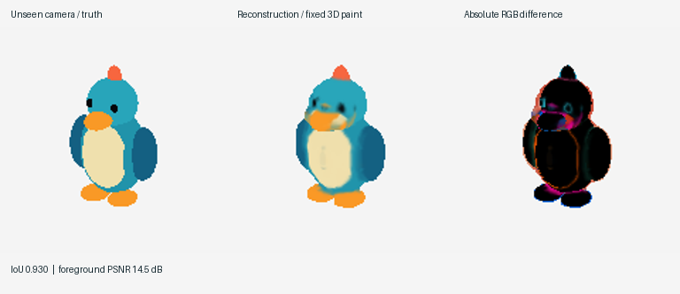
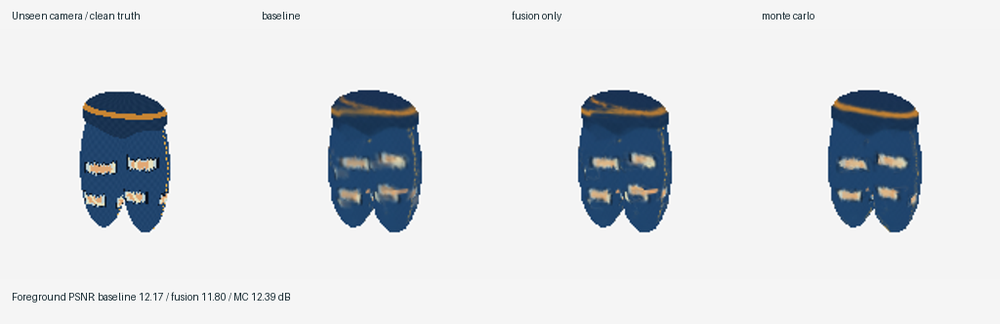
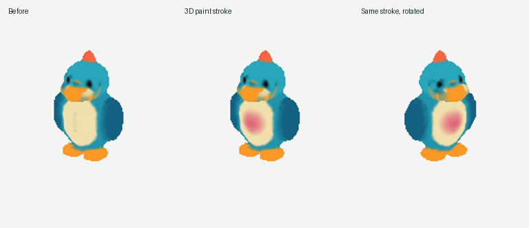

# Desina — drawings into painted, editable 3D

A CPU prototype that reconstructs a smooth implicit volume from registered multi-view silhouettes, fuses surface paint into a **view-independent 3D color field**, and lets you orbit, paint, add volume, carve, smooth, undo, and save. No meshes, neural training, pretrained models, API keys, or GPU are required.



The synthetic bird uses seven input cameras. Three different held-out cameras reach silhouette IoUs **0.930, 0.920, 0.857** (mean **0.902**). This is a promising baseline, not a general solution for arbitrary sketches: facial paint blurs, concavities are overfilled, and camera registration is provided by the artist.

## Inconsistent paint: shared-texture Monte Carlo experiment

The current paint fitter jointly optimizes continuous correspondence warps and a shared **3D RGB volume**. Its observation likelihood samples the same native volume as the renderer. It uses simple Monte Carlo warp proposals plus monotone canonical-color proposals, with no identified features, paired landmarks, neural networks, or pretraining. Multiple complete chain interpretations and uncertainty diagnostics are saved.

```sh
uv run desina paint-demo --out examples/paint-shared
uv run desina fit-paint model.npz drawings/project.json --out fitted.npz
uv run desina render fitted.npz --hypothesis 1 --flat --out alternative.png
uv run desina paint-benchmark --out examples/paint-validation
```



On the fixed fresh suite, aggregate color error falls **6.8% versus projection averaging** and **2.1% versus corrected pairwise fitting**, winning 11/12 and 6/12 runs respectively. PSNR stays nearly unchanged versus averaging. All per-run results, including regressions, are preserved.

Read [the shared-texture report](docs/shared-texture.md) for the reviewed bug fixes, sampler controls, retained alternatives, and the full fresh-corruption evaluation. The [original pairwise experiment](docs/paint-fitting.md) and its mixed results remain available in `examples/paint/`. Use `--objective pairwise` for the corrected earlier objective.

Geometry stays fixed during paint fitting. Cameras/silhouettes remain calibrated, and tear-like regions are paint. Precision-painting and input-correction tools are outside this iteration. The retained chain bank and uncertainty image are exploratory diagnostics, not a converged or calibrated joint posterior.

## Run

Python 3.14 and [uv](https://docs.astral.sh/uv/) match the original project setup.

```sh
uv sync --locked
uv run desina demo --out examples/bird
uv run desina studio examples/bird/bird.npz
```

The demo regenerates inputs, reconstructed `.npz` volumes, three held-out comparisons, `metrics.json`, a shaded preview, an editing comparison, and a turntable GIF. The checked-in results can be inspected immediately without running anything. `studio` is a local Tk desktop app and requires a graphical display plus a Python build with Tk support. The CLI and tests run headlessly. In environments with a read-only home directory, set `UV_CACHE_DIR=/workspace/work/uv-cache`.

In the studio, orbit using the sliders and click the visible surface for one brush stroke. Choose **Paint**, **Add**, **Subtract**, or **Smooth**, set radius/color, undo up to eight strokes, then **Save volume as…**. Painting changes color only; sculpting changes the implicit surface. **Reconstruct drawings…** loads a project JSON into a fresh volume. Rendering and reconstruction are synchronous; large projects can briefly block the window.



## Use your drawings

Export aligned **square** PNGs with the same framing. Use orthographic views as the first experiment: front, back, left, right, and preferably an elevated view. Center the object at the origin and keep it inside the world cube `[-1,1]^3`. `scale` is the image's world-space width and height; default 2.6 leaves a margin. Front is +z, right is +x, up is +y. Azimuth 0 looks from +z; 90 looks from +x; elevation 90 looks from above. There is no perspective camera fitting or automatic pose estimation yet.

```json
{
  "views": [
    {"image": "front.png", "camera": {"azimuth": 0, "elevation": 0, "scale": 2.6}},
    {"image": "side.png", "camera": {"azimuth": 90, "elevation": 0, "scale": 2.6}},
    {"image": "back.png", "camera": {"azimuth": 180, "elevation": 0, "scale": 2.6}}
  ]
}
```

Paths are relative to the project JSON. Each view can optionally include `"mask": "front-mask.png"` (white object, black background). Otherwise transparency supplies the silhouette. For opaque drawings on white, nonwhite pixels are detected and enclosed regions filled. A closed outer outline works; disconnected construction strokes, open silhouettes, shaded backgrounds, and holes need an explicit mask. Explicit masks also preserve white paint. All RGB pixels **inside** the mask are treated as paint, including white interiors and black sketch lines; use a cleaned paint pass if construction strokes should not appear on the object.

```sh
uv run desina reconstruct my-drawings/project.json --out model.npz --resolution 80
uv run desina render model.npz --azimuth 35 --elevation 22 --out novel-view.png
uv run desina render model.npz --azimuth 145 --flat --out flat.png
uv run desina studio model.npz
```

`--tolerance 1` gives silhouettes one pixel of slack for slight inconsistencies. `--smooth 0.7` smooths the distance field in voxel units. Larger slack inflates the shape; larger smoothing erases fine features. Grid resolutions 24–192 are accepted; 80 is the tested default. At 192, memory and CPU costs rise substantially.

## Scripted edits

Edits are world-space spherical brushes. For headless iteration, save strokes in `strokes.json`:

```json
[
  {"mode": "paint", "center": [0, -0.1, 0.32], "radius": 0.22, "color": [0.85, 0.12, 0.36]},
  {"mode": "subtract", "center": [0.4, 0, 0.2], "radius": 0.12},
  {"mode": "add", "center": [-0.4, 0, 0], "radius": 0.15},
  {"mode": "smooth", "center": [0, 0.4, 0], "radius": 0.2, "strength": 0.5}
]
```

```sh
uv run desina edit model.npz strokes.json --out edited.npz
uv run desina render edited.npz --out edited.png
uv run python -m unittest discover -s tests -v
```

The `.npz` holds `sdf` (negative inside), `color` (fixed linear interpolation of RGB values), and JSON `metadata` including brush history. This is an editable sampled implicit representation, not a triangle mesh. RGB values are fused directly in input sRGB space; physically correct reflectance/lighting separation is outside this prototype. New sculpted regions inherit nearby volume paint. Reconstructing from changed drawings starts over; it does not replay previous edits automatically.

## Method and evidence

1. Backproject silhouette signed distances into a 3D grid; intersect the resulting generalized cylinders (visual hull).
2. Re-distance occupancy and apply modest Gaussian regularization. This is not the curvature-energy optimization from the cited neural papers.
3. Trace the first surface from each input camera. Project paint only onto visible, front-facing shell samples; weight by normal/view alignment. Nearest observed surface paint fills unseen regions, explicitly as a guess.
4. Render the zero level set with grid traversal and bisection. Sample the same spatial paint field for every camera.
5. Apply 3D color brushes or constructive implicit sphere operations directly to the volume.

The synthetic ground truth is an **independent exact ray/ellipsoid intersection renderer** with world-space paint patterns. Reconstruction sees only seven PNGs and camera hints, never primitive identities, depths, or held-out images. The analytic renderer is confined to `demo.py`. Evaluation uses flat colors to avoid introducing lighting differences. PSNR is measured over the union of foreground masks, rather than being inflated by the large white background. Metrics and full camera definitions are in [metrics.json](examples/bird/metrics.json).

Thirteen automated checks cover analytic sphere hits, unseen bird reconstruction, front/back visibility separation, painting from two views, persistent paint/sculpt edits, closed-outline and explicit-mask loading, and invalid input handling. The desktop UI imports/compiles successfully but was not interactively tested in this headless environment.

Read [research notes](docs/research.md) for the referenced methods, alternatives, limitations, and next experiments.
