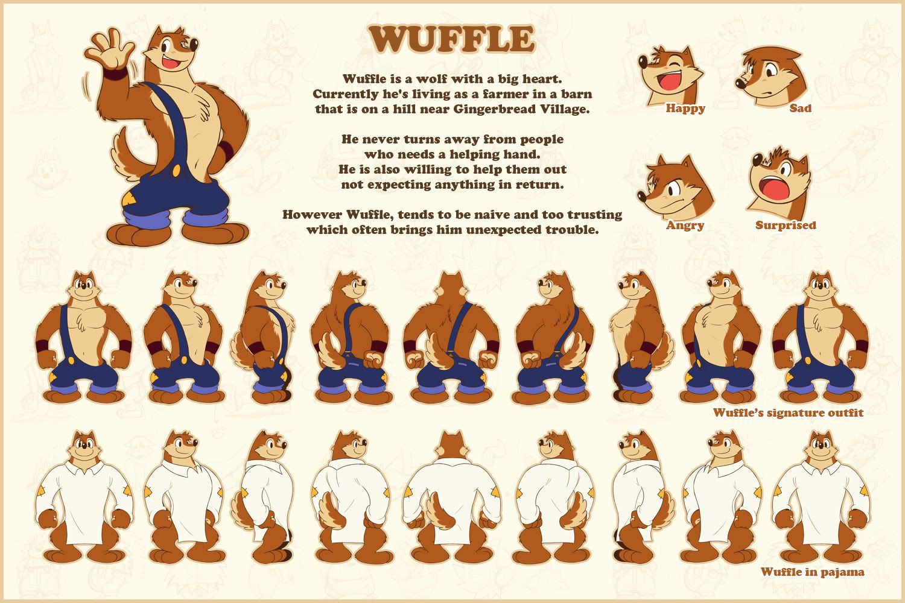
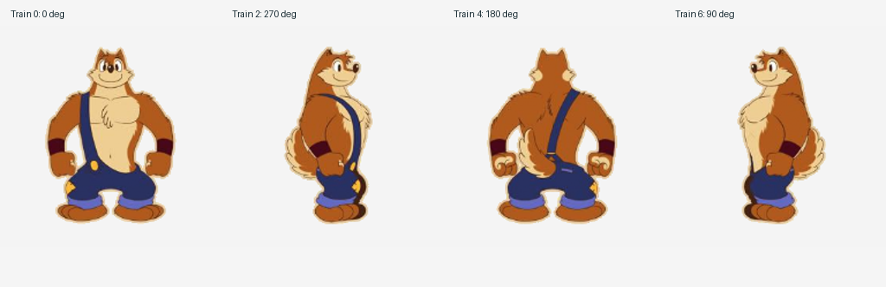
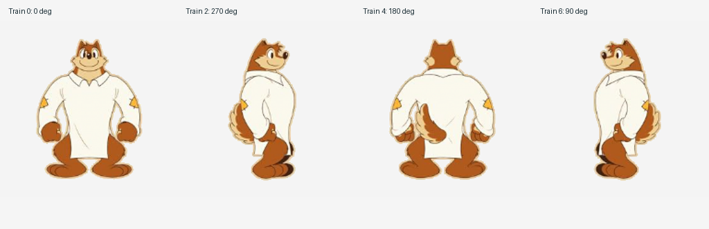
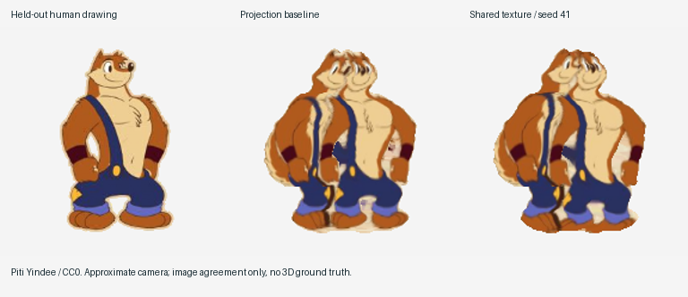
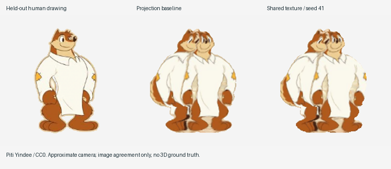
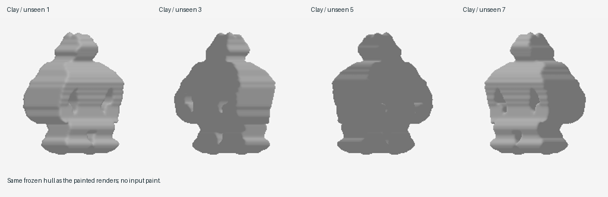
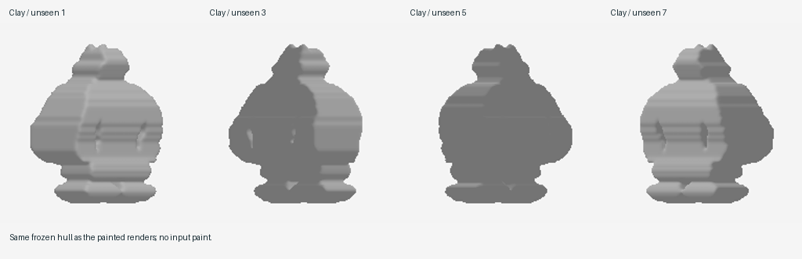
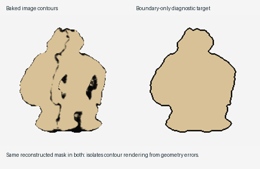
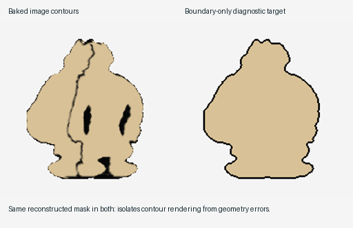
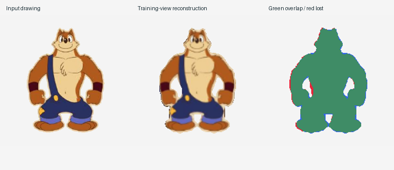

# Human-drawn character-sheet stress test

**The current approach does not transfer well enough to these drawings to justify
another paint-fitting iteration.** The character remains recognizable, but unseen
views contain doubled faces, stripes of misplaced color, and an overfilled body.
Both sampler seeds slightly worsen average held-out color error in both outfits.
The contour control demonstrates a representational problem that better paint
registration alone cannot solve. The small pose-like control, however, does
**not** demonstrate catastrophic sensitivity.

This experiment freezes the reconstruction and paint fitter at
[`e6e2689`](https://github.com/amongonz/desina-prototype/commit/e6e2689b74f34f5d14a1a84fa0899d6dc51b117b).
It tests whether the earlier synthetic results transfer to an actual artist's
character sheet before spending more effort on texture optimization.

## Inputs and provenance

The input is **Wuffle — Character Model Sheet (second version)** by **Piti Yindee**
(2012), released under **CC0 1.0**. It contains two eight-view turnarounds:
the character's signature outfit and pajamas. This is one character drawn by
one artist, not two independent character datasets.



The original was obtained from the public ModelSheetTo3D research repository.
That repository also contains AI-edited crops and a generated mesh; none of those
assets, its code, its camera assignments, or its models were used here.
See [artwork attribution and exact download provenance](../examples/artist-sheets/ATTRIBUTION.md)
and the [primary Commons license record](https://commons.wikimedia.org/wiki/File:Piti_Yindee_-_Wuffle_-_Wuffle_-_Character_Model_Sheet_(second_version).jpg).

Only the front, two profiles, and back enter reconstruction. The four diagonal
drawings are held out. Camera yaw comes from the apparent turnaround order;
all cameras have zero elevation and an approximate common orthographic scale.
There is no camera fitting or claim that the artist used orthographic projection.




Preparation uses rectangular crops, a common scale, translation, an ink threshold,
hole filling, the largest connected component, and recorded background seeds
to preserve enclosed arm/leg gaps. This supplies explicit masks, including white
clothing. It does not locally align the drawings, change proportions, repaint
details, or establish feature correspondences. The full source sheet and every
preparation parameter are retained. A pilot exposed feet clipping the world cube;
framing was corrected and all final results regenerated. The final preparation
asserts that every silhouette fits inside the volume.

## Frozen protocol

- Geometry: existing hard silhouette intersection, resolution 80, tolerance one
  input pixel, smoothing 0.7 voxel. No geometry updates during paint fitting.
- Images: 192 × 192; texture volume: 128³. Existing default shared-texture
  options: three chains, 350 proposals per view/scale/chain, 1,800 surface samples.
- Sampler seeds: **41 and 73**, for both outfits. Every run and all four held-out
  views are reported. Figures and saved fitted volumes use seed **41**, selected
  in advance. No winner selection or hyperparameter sweep.
- The baseline averages projected RGB; the fitted method uses the existing
  robust shared-volume likelihood and continuous Monte Carlo paint warps.
- The [manifest](../examples/artist-sheets/manifest.json) records source hashes,
  options, camera hints, crops, seeds, and diagnostic definitions. The three
  reconstruction/fitting files were verified byte-identical to the frozen commit.

There is **no 3D ground truth**. Held-out scores measure agreement with another
drawing, which can itself differ in pose, proportion, perspective, and painted
detail. These scores cannot isolate pose from camera error, and cannot certify
correct depth or anatomy. The two outfits are related observations, not a broad
generalization benchmark.

## Results

Each row averages the four held-out diagonal drawings. Fitted values average
both seeds; the geometric silhouette is identical before and after paint fitting.
Color MAE is measured in overlapping foreground, with RGB normalized to [0, 1].
PSNR uses the union of the foreground masks, so missing/excess silhouette also
affects it. Higher IoU and PSNR are better; lower color MAE is better.

| Outfit | Novel-view IoU | Baseline color MAE | Fitted color MAE | Baseline / fitted PSNR |
| --- | ---: | ---: | ---: | ---: |
| Signature | 0.747 | 0.1745 | 0.1775 | 8.97 / 8.83 dB |
| Pajamas | 0.760 | 0.1596 | 0.1608 | 11.01 / 10.92 dB |

For the signature outfit, seed 41 scores 0.1794 MAE and seed 73 scores 0.1755;
for pajamas they score 0.1609 and 0.1606. Thus the mean regressions of **1.7%**
and **0.7%** are not caused by averaging one successful and one failed seed.
Image-gradient error slightly improves for the signature outfit and slightly
worsens for pajamas; neither outcome fixes the visible defects.

The face is painted more than once around the inferred head. The suspenders,
chest boundaries, shirt folds, and feet form strips rather than one coherent
surface design. The pajamas case fails too, despite using broad pale regions
instead of the signature outfit's more contrasting colors. Shape-only renders
show that the issue is not all paint: the hull is broad and blocky in diagonal
views, and the independent front/profile constraints provide little information
about how to round or recess the torso and face.




The geometry-only renders make it possible to distinguish the shape inferred
from silhouettes from defects introduced by projected painting:




## Contour diagnostic

The actual drawings combine surface colors with silhouette lines, interior
overlaps, and graphic conventions. To isolate one incompatibility, a diagnostic
replaces each training image's colors with uniform cream and draws a black
two-pixel line **inside its silhouette**. This uses the human masks, but the
diagnostic paint is synthetic. The same frozen projection baker transfers these
lines to the reconstructed volume.

For each held-out camera, the right panel below uses exactly the same rendered
mask, with the line drawn at its current boundary. It is a diagnostic target,
not an alternative reconstruction method or an artist-drawn ground truth.
Consequently, differences between these panels cannot come from silhouette
or camera disagreement.

| Outfit | Dark pixels inside the eroded rendered foreground | Current boundary covered by dark paint |
| --- | ---: | ---: |
| Signature | 8.4% | 36.8% |
| Pajamas | 7.5% | 38.4% |

“Interior” excludes four pixels from the current boundary; “dark” means mean
RGB below 0.35. A correctly boundary-only drawing has zero dark pixels there.
The original image-boundary paint becomes interior stripes and blobs as the
surface rotates, while much of the new silhouette has no dark line. The test
uses the original projection baker, not a newly optimized contour model. It
isolates why baking all drawn lines into fixed surface RGB is insufficient;
it does not prove that every possible 3D representation of line art must fail.




## Pose and silhouette diagnostics

Training-view comparisons mark retained foreground green, omitted foreground
red, and excess silhouette blue. Leave-one-view-out hulls show the effect of
each individual silhouette constraint. This is an ablation, not a tuned result.



A separate sensitivity control moves one small front-view region smoothly by
up to **four original-sheet pixels** (1.4% of the input canvas width), warping
**RGB and silhouette together**. The other three views stay fixed and the hull
is reconstructed again. This is a controlled *2D pose-like perturbation*, not
an articulated 3D motion, a new artist drawing, or a test of pose recovery.
It avoids the previous experiment's assumption that only RGB changes while
the silhouette stays perfectly registered.

| Outfit | Input foreground changed | Original hull volume removed | Volume symmetric difference |
| --- | ---: | ---: | ---: |
| Signature | 2.9% | 0.54% | 2.17% |
| Pajamas | 2.7% | 0.77% | 1.44% |

These changes are modest. Likewise, the unperturbed hull retains **97.4%** and
**96.8%** of the training foreground on average (training IoU 0.952 and 0.943).
This sheet therefore does not show wholesale limb deletion from small pose
differences. Omitting individual views increases volume by only 0.4–7.2%.
The hard intersection still has no mechanism to infer a shared neutral pose
or distinguish a pose difference from a shape difference; paint fitting cannot
change that. Stronger articulated discrepancies remain untested.

This evaluation also changes the number of inputs: the earlier paint benchmark
used nine calibrated views, whereas each real turnaround supplies four training
views. Camera uncertainty, view count, artistic proportions, and line semantics
are confounded in the full-image comparison. The contour control isolates one
failure; the rest should not all be attributed to pose.

## Decision and next experiment

**Pause improvements to the current fixed-hull paint fitter.** Keep it as an
editable baseline and keep these actual drawings as a small regression set.
Increasing the number of color samples or chains would not address the missing
variables exposed here.

The next narrowly scoped experiment should change the observation model:

1. **Replace the hard hull constraint with a soft silhouette likelihood.**
   Jointly sample coarse canonical shape, small camera corrections, and small
   smooth per-view deformations. A spatial control grid can express these
   proposals without named parts, landmarks, feature matches, or pretrained
   models. Apply each deformation to geometry and attached paint together and
   recompute visibility. Strong size and deformation priors are necessary to
   prevent unrestricted inflation or arbitrary per-view explanations.
2. **Give dark strokes multiple probabilistic explanations.** A continuous,
   spatially regularized mixture can assign likelihood to attached surface
   paint, view-dependent silhouette/occlusion contours, or a drawing outlier.
   Marginalize those alternatives rather than detecting and matching named
   features. Geometry-derived contours should be rendered from the current
   camera; permanent design marks should remain in the canonical paint field.
   This is a proposed model, not a classifier already demonstrated to work.
3. **Gate further work on these held-out drawings.** First remove the migrating
   contour stripes in the isolated control, then improve diagonal shape without
   losing training limbs or letting the per-view deformations absorb everything.
   Add a genuinely different artist/character and actual pose differences before
   making claims about general reconstruction.

This remains compatible with simple Monte Carlo proposals and an untrained
implicit representation. It does require fitting shape and rendering semantics,
not just making the existing color-registration objective more elaborate. No
such reconstruction changes were made in this iteration.

## Inspect and reproduce

```sh
uv sync --locked
uv run python experiments/artist_sheets.py
uv run desina studio examples/artist-sheets/signature/fitted.npz
uv run desina render examples/artist-sheets/signature/fitted.npz --azimuth 315 --elevation 0 --scale 2.4 --flat --out novel.png
```

The script regenerates masks, manifests, all comparisons, two-seed metrics,
contour and pose controls, leave-one-view-out diagnostics, editable volumes,
and [signature](../examples/artist-sheets/signature/turntable.gif) /
[pajamas](../examples/artist-sheets/pajamas/turntable.gif) turntables.
Full measurements are in [summary.json](../examples/artist-sheets/summary.json)
and each outfit's `metrics.json`. No neural network, pretrained representation,
generative image model, feature detector, or external correspondence model is
used in the reconstruction or data preparation.
