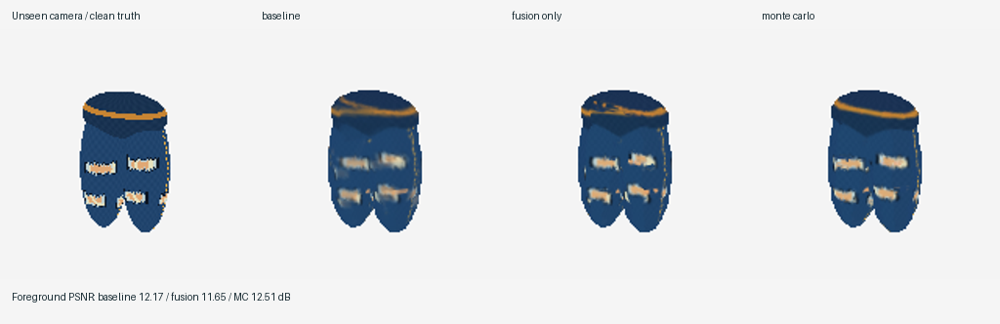

# Monte Carlo fitting of inconsistent paint

This second experiment replaces direct paint averaging with feature-free probabilistic correspondence fitting and robust mode fusion. It uses no neural networks, pretrained descriptors, datasets, named regions, paired landmarks, or per-detail annotations. The SDF is held fixed: this experiment isolates texture reconciliation. Cameras and silhouettes still need to be supplied as in the original prototype.



## Try it

```sh
uv run desina paint-demo --out examples/paint
uv run desina studio examples/paint/fitted.npz
```

For existing drawings and a reconstructed model:

```sh
uv run desina fit-paint model.npz drawings/project.json --out fitted.npz
uv run desina render fitted.npz --azimuth 23 --elevation 18 --flat --out novel.png
uv run desina render fitted.npz --azimuth 23 --elevation 18 --uncertainty --out uncertainty.png
```

The output is the same editable `.npz` format. Old models still load. Paint resolution is now independent of geometry resolution: a finer RGB volume retains more detail without requiring a finer SDF. The existing studio and world-space brushes continue to work. No new precision-painting, input-correction, or annotation UI was added in this iteration.

## What is sampled

For each view, a small 2D control grid defines a **continuous piecewise-bilinear displacement field** in normalized image coordinates. A surface point projects to an input-image position, and the field moves that position before sampling paint. All correspondence hypotheses are continuous spatial maps; no semantic features or pixel keypoints are matched.

The Monte Carlo proposal code has three small branches in `paint.py:propose`:

1. Translate the field.
2. Add an affine tilt.
3. Add a smooth Gaussian bump with a random center and radius.

These proposals alter neighborhoods coherently. Control bounds limit displacement; a displacement-Jacobian contraction bound prevents folds. Squared displacement and neighbor-difference priors favor small, regular changes. A mask-support penalty discourages moving evidence outside the object.

Surface quadrature locations are randomly selected once with a fixed seed from jointly visible surface samples. They remain fixed during a run, so Metropolis acceptance compares the same approximate objective on each move. They are not content-dependent detected features. Input visibility is calculated from the fixed geometry before fitting; correspondence shifts cannot freely change which surfaces are visible.

At each sample, geometrically overlapping views supply two RGB observations. Their discrepancy is scored by a Gaussian-inlier/uniform-outlier mixture. The fixed outlier probability makes a contradictory stroke possible, but never free. Pair weights depend on visibility and viewing angle. The objective is the normalized sum of these pairwise costs plus the regularizers and mask-support penalty.

This is a **pairwise composite-likelihood approximation**, followed by robust texture fusion, rather than a complete generative model jointly solving shape, cloth layers, lighting, pose, and paint. For energy E and temperature T, the sampler targets a generalized distribution proportional to exp(-E/T) over bounded valid control fields. Three progressively finer image scales and decreasing temperatures find a low-energy joint warp hypothesis. Independent chains provide restarts. Identity warps are retained as a fallback if no sampled solution improves the final objective.

By default every view can move. The displacement prior keeps paint close to geometric projection; it does not identify a uniquely correct material-coordinate system. `--reference 0` can pin the first view if desired, but this can propagate that drawing's own distortion into the shared texture. No clean reference is secretly provided in the benchmark.

A short fixed-temperature Metropolis tail retains 12 joint control-field draws as empirical correspondence alternatives. **There is no claim that these short chains converge or that uncertainty is calibrated.** Different texture arrangements remain possible; the retained draws describe only local alternatives found by this search.

## Why the output does not average conflicting hypotheses

The output uses the lowest-energy joint warp state found by the search. At each surface sample, aligned source colors receive agreement and visibility scores. Four local source-selection sweeps encourage neighboring samples to use compatible source views. A selected supported color mode is written to the shared 3D RGB field. This is approximate mode selection, not exact global MAP inference.

The source index is just a view number: it does not identify a tear, trouser leg, or any semantic region. Fine paint and distinct warp hypotheses are not averaged together. Interpolation during image sampling and final volume rendering still limits sharpness. Missing surface paint is extended from the nearest observed shell sample.

Rendering samples the fixed RGB volume only. Neither camera-dependent input selection nor warp evaluation happens at render time, so marks stay attached as the object rotates.

## Saved diagnostics

Additional arrays in `.npz` files are optional and backward compatible:

- `uncertainty`: scalar volume in [0,1], combining residual color disagreement, sparse coverage, and empirical displacement spread.
- `paint_warps`: selected controls, shape `(views, knots, knots, 2)`, in normalized image-coordinate units.
- `paint_samples`: retained joint warp draws, shape `(draws, views, knots, knots, 2)`.

The JSON metadata includes all settings, initial/final energies, chain acceptance rates, per-view source fractions, tail displacement spread in pixels, timings, and view names. The uncertainty volume is an exploratory fit diagnostic, not a calibrated probability of error, and is not updated by subsequent painting/sculpting. It can be overconfident when chains get trapped in the same wrong correspondence.

## Tunable parameters

| Parameter | Default | Meaning |
| --- | ---: | --- |
| `--steps` | 350 | Proposals per movable view, per scale, per chain |
| `--chains` | 3 | Independent annealed restarts |
| `--samples` | 1800 | Fixed random surface quadrature budget |
| `--knots` | 4 | Width/height of each control grid |
| `--max-warp` | 0.065 | Maximum per-axis displacement as an image-width fraction |
| `--displacement-prior` | 0.025 | Cost of moving away from geometric projection |
| `--smoothness-prior` | 0.06 | Cost of changes between neighboring controls |
| `--outlier-rate` | 0.12 | Mixture weight for unexplained RGB observations |
| `--temperature` | 0.008 | Initial exploration scale; decreases during each stage |
| `--posterior-draws` | 12 | Number of exploratory fixed-temperature tail draws |
| `--texture-resolution` | 128 | RGB/uncertainty cube resolution; SDF is unchanged |
| `--reference` | -1 | Optional pinned view index; -1 pins no view |
| `--seed` | 7 | Reproducible quadrature, proposals, and restarts |

Other numerical constants, including final/tail temperatures, likelihood scales, blur scales, and local source-coherence strength, are explicit in `paint.py`. Increase budgets before increasing warp freedom. Larger control grids can explain more drawing distortion but create more opportunities to align unrelated repeated patterns. The maximum warp cannot recover arbitrarily different poses.

## Benchmark and result

`paint_demo.py` uses exact ray/ellipsoid intersections to generate a trouser-shaped object with plaid, seams, a belt, and ragged tear-like paint. Each of nine views receives independent sinusoidal texture-coordinate distortions, slight color differences, and occasional unmatched strokes. The distortion is analytic and is not generated using the fitter's control-grid family. All views, including the first, are imperfect. Silhouettes remain calibrated, deliberately isolating paint inconsistency.

The fitter receives only the observed PNGs, camera hints, and the SDF reconstructed from those silhouettes. It never receives clean training views, true warp fields, material IDs, feature masks, or held-out truth. The procedural renderer and corruption code are confined to `paint_demo.py`.

The checked-in run uses geometry 80 cubed, texture 128 cubed, images 160 square, distortion amplitude 0.035 image widths, and the default sampler settings. The original projection-and-average baseline and the robust-fusion-only ablation use the **same reconstructed geometry and texture resolution** as the Monte Carlo result. Fusion-only also uses the same surface sampling, source-selection rule, and paint representation as the fitted result, but identity correspondences. No method is evaluated on a training camera.

| Held-out azimuth / elevation | Baseline overlap MAE | Fusion-only overlap MAE | MC overlap MAE | Baseline / MC foreground PSNR |
| --- | ---: | ---: | ---: | ---: |
| 23 / 18 | 0.0973 | 0.0999 | 0.0795 | 12.17 / 12.51 dB |
| 113 / -8 | 0.0779 | 0.0772 | 0.0679 | 12.61 / 12.56 dB |
| 248 / 25 | 0.0570 | 0.0557 | 0.0520 | 13.61 / 13.41 dB |

Mean overlap RGB MAE falls from about **0.0774 to 0.0665 (14.1%)**. Mean foreground PSNR changes only from **12.80 to 12.82 dB**; two views regress slightly on PSNR. Sharper but imperfectly positioned boundaries can reduce average absolute error while still incurring large squared errors. The regularized fitting energy falls from 1.338 to 0.745. Fitting took about 42 seconds in this environment; performance varies.

This meets the original loose visual criterion: novel angles resemble the clean procedural design and some texture smearing is reduced. It is **not** strong evidence of reliable artist-sheet reconstruction. The mixed metrics, imperfect seam positions, and limited detail remain visible in all three checked-in comparison images. Full precision values and settings are in `examples/paint/metrics.json`; the GIF shows baseline on the left and fitted paint on the right.

## Limits

- This is a fixed-geometry texture experiment. Perspective estimation, camera fitting, pose recovery, robust silhouette fitting, and true cloth-hole inference are not implemented here.
- Tear-like marks are **painted representations**, not actual openings. A skin-colored region cannot reliably tell the method whether cloth is missing, folded, shadowed, or decorated. Real openings require additional geometry/material layers and their own inference model.
- Severe pose changes, inconsistent topology, repeated patterns, and under-observed surfaces can yield plausible but incorrect correspondences. Sampling and outlier probabilities do not manufacture missing information.
- All appearance is baked input RGB. Lighting and view-dependent illustration effects are not separated automatically.
- The benchmark is one procedurally generated design with synthetic inconsistency, not real artist artwork. More shapes and actual paintings are necessary before claiming generality.
- Chains are short and source selection is approximate. The output is one low-energy interpretation, not proof of a unique or correct recovered design.

## Verification and provenance

Ten automated tests cover the original geometry pipeline plus recovery of an independently imposed image shift, fixed-geometry behavior, retained samples, deterministic seeds, supported color-mode selection, invalid/non-overlapping inputs, finer RGB volumes, and backward-compatible saved-model round trips. Rendering is explicitly checked to produce the same image after removing stored warp/sample arrays, proving that those arrays are diagnostics rather than a view-dependent rendering mechanism. The fit/render/uncertainty CLI round trip was also exercised.

The registration idea is related to [Coherent Point Drift](https://arxiv.org/abs/0905.2635), which estimates probabilistic correspondences under coherent nonrigid motion. It is not an implementation of CPD, and no code or assets were copied from it. [Let There Be Color!](https://download.hrz.tu-darmstadt.de/pub/FB20/GCC/paper/Waechter-2014-LTB.pdf) provides context for view-source selection and the limitations of blending misregistered paint. The previously discussed [model-sheet reconstruction paper](https://doi.org/10.1111/cgf.70323) motivates separating inconsistent drawing observations, but its pretrained initialization is not used. All code, procedural paint, and scene definitions in this experiment were created in this repository.
